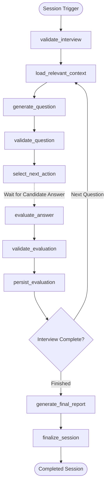

# PrepPulse — Architecture & Technical Specifications

> **Official Title**: PrepPulse — An AI-Powered Intelligent Interview Preparation and Evaluation System  
> **Tagline**: Practice Smarter. Perform Stronger.

---

## 1. High-Level Architectural Topology

PrepPulse employs a decoupled microservice architecture:

```
┌────────────────────────────────────────────────────────┐
│                   React (JavaScript + JSX)             │
│   (Vite, Tailwind CSS v4, Lucide React, Recharts)     │
└───────────────────────────┬────────────────────────────┘
                            │ HTTPS / REST (JWT Bearer) - Port 8000
┌───────────────────────────▼────────────────────────────┐
│      Node.js + Express + JavaScript (ES Modules)       │
│  - Argon2id Password Hashing (RFC 9106)                │
│  - JWT Authentication & Authorization Middleware       │
│  - Zod Request Schema Validation & Error Handling      │
│  - Interview Session State & Questions/Answers CRUD     │
│  - Analytics Engine (6-Axis Interview DNA, Skill Tree) │
│  - Gamification Engine (XP, Streaks, Milestones)       │
└───────────────┬────────────────────────┬───────────────┘
                │                        │ Internal REST / JSON (Port 8001)
                │                        │ X-Internal-Secret Protected
                │               ┌────────▼───────────────┐
                │               │  Python AI Service     │
                │               │  (FastAPI + LangGraph) │
                │               │  - 10-Node Workflow    │
                │               │  - Groq Llama-3.3 LLM  │
                │               │  - 4-D Answer Scorer   │
                │               │  - Calibrated Fallback │
                │               └────────┬───────────────┘
                │                        │
┌───────────────▼────────────────────────▼───────────────┐
│                 MongoDB Data Storage                   │
│   (Official Node MongoDB Driver / Motor Async Driver)  │
│   - users, interviews, questions, answers,             │
│   - evaluations, achievements, practice_activity       │
└────────────────────────────────────────────────────────┘
```

---

## 2. LangGraph 10-Node Stateful Workflow

The interview lifecycle is orchestrated by a stateful `StateGraph`:



### Detailed Node Specifications

| Node ID | Function | Inputs & Constraints |
| :--- | :--- | :--- |
| `validate_interview` | Verifies interview existence, user ownership, and `in_progress` status. | `interview_id`, `user_id` |
| `load_relevant_context` | Extracts only the target role, difficulty, and selected topics. Token-efficient: excludes previous question history. | `job_role`, `difficulty`, `topics` |
| `generate_question` | Invokes Groq Llama with structured output (`QuestionGenOutput`) containing rubric and expected concepts. | System prompt + target topic |
| `validate_question` | Enforces non-empty questions, topic matching, and at least 2 required architectural concepts. | Pydantic validation |
| `evaluate_answer` | Analyzes submitted answer against rubric across 4 dimensions: Technical Accuracy, Relevance, Completeness, Clarity. | Question, rubric, candidate text |
| `validate_evaluation` | Asserts scores are within 0–100, detects missing concepts, and validates model answer. | `AnswerEvalOutput` schema |
| `persist_evaluation` | Saves evaluation record to MongoDB, awards XP, and updates session progress. | Database insert |
| `select_next_action` | Determines whether to advance question index or branch to session finalization. | Index comparison |
| `generate_final_report` | Calculates aggregate score, identifies strongest and weakest topics, and generates remediation advice. | Evaluations list |
| `finalize_session` | Sets status to `completed`, writes completion timestamp, and triggers gamification milestone updates. | Database update |

---

## 3. MongoDB Schema & Indexing Strategy

All collections enforce explicit compound and unique indexes created on startup:

### 3.1 Collections & Fields

- **`users`**:
  - `_id`: ObjectId
  - `name`: string
  - `email`: string (unique index)
  - `password_hash`: string (Argon2id)
  - `profile`: `{ target_role, target_level, experience_years, primary_language }`
  - `preferences`: `{ theme, timed_mode_default, sound_enabled }`
  - `created_at`, `updated_at`: ISO datetime
- **`interviews`**:
  - `_id`: ObjectId
  - `user_id`: string (indexed)
  - `job_role`: string
  - `interview_type`: `'technical' | 'behavioral' | 'system_design' | 'hr'`
  - `difficulty`: `'junior' | 'mid' | 'senior' | 'staff'`
  - `selected_topics`: list[string]
  - `total_questions`: int
  - `current_question_index`: int
  - `status`: `'in_progress' | 'completed' | 'abandoned'`
  - `final_score`: float (nullable)
  - `timed_mode`: boolean
  - `created_at`, `completed_at`: ISO datetime
  - *Compound Index*: `{"user_id": 1, "status": 1}`
- **`questions`**:
  - `_id`: ObjectId
  - `interview_id`: string (indexed)
  - `user_id`: string (indexed)
  - `question_text`: string
  - `topic`: string
  - `difficulty`: string
  - `expected_concepts`: list[string]
  - `evaluation_rubric`: dict
  - `order`: int
  - *Compound Index*: `{"interview_id": 1, "order": 1}`
- **`answers`**:
  - `_id`: ObjectId
  - `interview_id`: string
  - `question_id`: string (indexed)
  - `user_id`: string
  - `answer_text`: string
  - `submitted_at`: ISO datetime
  - *Unique Compound Index*: `{"interview_id": 1, "question_id": 1}` *(Prevents duplicate submissions)*
- **`evaluations`**:
  - `_id`: ObjectId
  - `interview_id`: string (indexed)
  - `question_id`: string (unique index)
  - `user_id`: string (indexed)
  - `technical_accuracy`: float (0–100)
  - `relevance`: float (0–100)
  - `completeness`: float (0–100)
  - `clarity`: float (0–100)
  - `overall_score`: float (0–100)
  - `strengths`: list[string]
  - `missing_concepts`: list[string]
  - `feedback`: string
  - `model_answer`: string
  - `model_identifier`: string
  - `created_at`: ISO datetime
- **`achievements`**:
  - `_id`: ObjectId
  - `user_id`: string
  - `achievement_key`: string
  - `earned_at`: ISO datetime
  - *Unique Compound Index*: `{"user_id": 1, "achievement_key": 1}`
- **`practice_activity`**:
  - `_id`: ObjectId
  - `user_id`: string (indexed)
  - `activity_type`: string
  - `topic`: string
  - `xp_awarded`: int
  - `created_at`: ISO datetime

---

## 4. Token & Cost Efficiency Strategy

1. **Context Isolation**:
   - The question generator only receives the current topic and role. It never receives full conversation history.
   - The evaluation node receives only the question, rubric, and candidate answer. Historical question exchanges are never concatenated into the evaluation prompt.
2. **Deterministic Metric Calculations**:
   - Aggregate interview scores, streak counts, level calculations, and historical charts are computed directly in Python/MongoDB rather than paying LLM token costs.
3. **Calibrated Offline Engine**:
   - When no `GROQ_API_KEY` is supplied or when rate limits are exceeded, the system automatically falls back to an internal rubric evaluation engine so testing and evaluation never fail.
